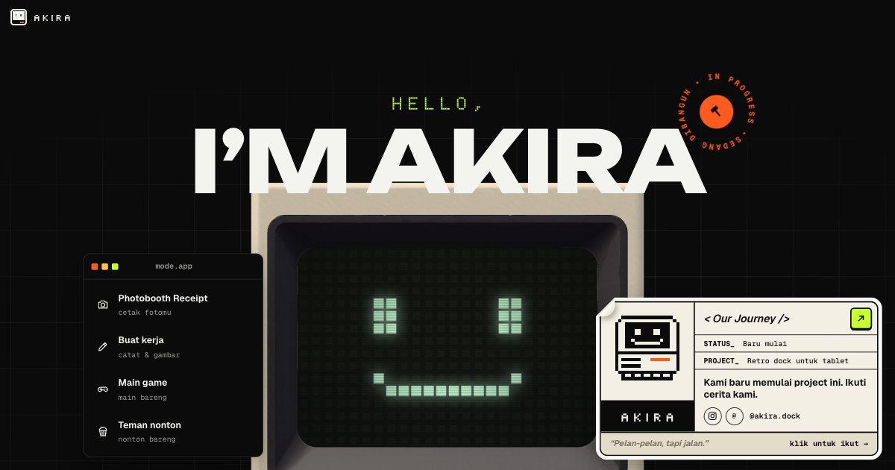

# Akira

**A retro dock for tablets.** Phones on the same Wi-Fi become game controllers for the iPad.

**[Visit the landing page →](https://yamustofa.github.io/akira-dock/)**

## Related repositories

- [akira-arcade](https://github.com/yamustofa/akira-arcade): Akira Arcade, built on Delta (Swift)
- [akira-arcade-provenance](https://github.com/yamustofa/akira-arcade-provenance): Akira Arcade on Provenance, with PS1 support

## About this repo

This repo holds the static build of the landing page, served with GitHub Pages and available in multiple languages. It's a build artifact, so the files here aren't edited by hand.

Made by [Habib Mustofa](https://github.com/yamustofa).
